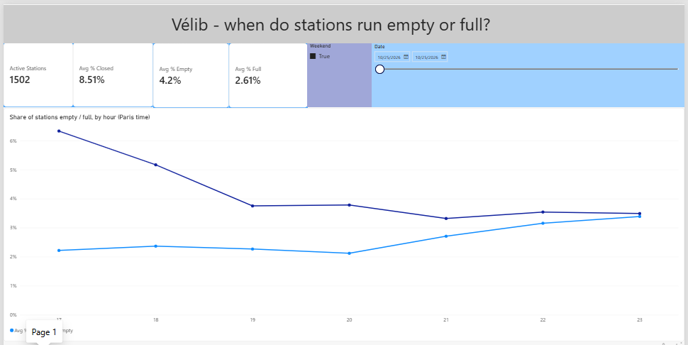
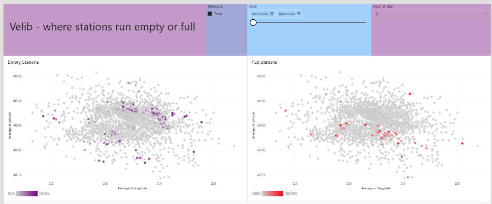
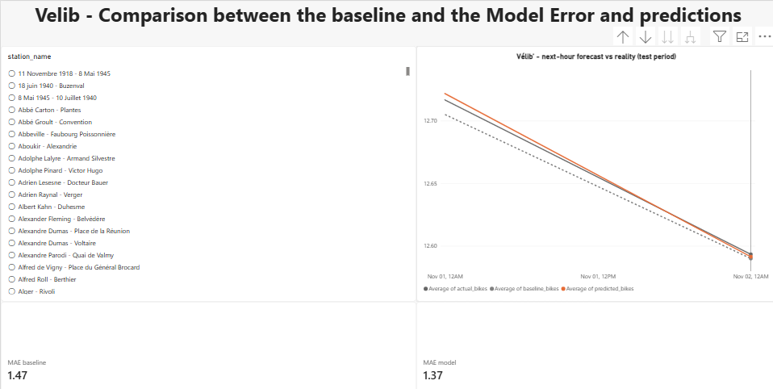

# Vélib' pipeline

I'm building a small data pipeline around Vélib', the bike sharing system in Paris.
Every 5 minutes it saves the state of all ~1,500 stations: how many bikes are there,
how many docks are free, and how many of the bikes are electric.

The goal is to take this raw data all the way to something useful: clean tables,
a dashboard, and in the end a model that guesses how many bikes a station will have
in one hour.

I'm building it step by step, so some parts are not there yet (see the plan at the bottom).

## Why Vélib'

The data is real, public and changes all the time. There's a lot to look at:
morning and evening rush hours, stations that are always empty or always full,
and the weather changing how people ride. It's a good project to practice data
engineering, analysis and a bit of machine learning on the same data.

## What I found so far

**The morning commute moves bikes from homes to offices.** Between 9h and 11h (Paris time),
the share of empty stations almost triples compared to early morning (about 3% to 9%),
and the share of full stations is at its highest too. Bikes leave residential areas and pile
up near offices. In the evening it goes the other way. This is the classic bike sharing
problem called rebalancing: Vélib' has to move bikes around by truck.

| Hour (Paris) | Empty stations | Full stations |
|---|---|---|
| 6h | 2.8% | 2.7% |
| 8h | 4.2% | 1.3% |
| 10h | 8.4% | 4.5% |
| 18h | 6.2% | 1.6% |

**The empty stations are on the hills.** On the map at 9h, most empty stations are around
Montmartre and Belleville / Ménilmontant: areas where people live, and on top of a hill.
People ride down to work in the morning, but very few ride back up. The full stations are
in the center and in the lower, flatter parts of the city.

The Excel report says the same thing. Of the 10 stations most often empty on weekday mornings
(8h to 10h), almost all are on a hill: Lacépède - Monge near the Panthéon (empty 100% of the
time), Lepic and Tardieu - Chappe on Montmartre, Pyrénées - Ménilmontant in Belleville...
The one exception is Place de la République, which is flat but is a big metro hub.

**Weekends have no morning rush.** At 9h, 5% to 10% of stations are empty on weekdays,
but only about 3% on Saturday and Sunday. On weekends the busy time is the afternoon
instead (around 16h), which looks like leisure trips.

These numbers are from the first two weeks only (and one weekend), so they will change as
more data comes in.

## The dashboard

Made in Power BI, on top of the dbt tables (file: `dashboard/velib.pbix`).

**Page 1: when do stations run empty or full?**
The share of empty and full stations for each hour of the day, with filters for the date
and weekday / weekend.



**Page 2: where?**
Every station placed by its coordinates and colored by how often it's empty (or full)
at the hour you pick.



**Page 3: forecast vs reality.**
For the station you pick: the real number of bikes, the model's prediction and the
"last hour" baseline, hour by hour over the test period, with the error of each.



A few things I was careful about:

- Percentages are averaged, never added up.
- One scale for both lines, starting at 0, so the chart doesn't make small changes look big.
- Closed stations don't count as empty or full. A closed station with 0 bikes isn't
  "empty", it's just closed.
- The date and weekend filters are shared between the first two pages.
- The built-in map visual needs a work or school Microsoft account, so I used a scatter
  chart with longitude and latitude instead. No streets in the background, but every
  station is in the right place.

## Excel report

`reports/velib_report.xlsx` has two pivot tables, made from a CSV export of the dbt tables:

- **Morning rush:** the 10 stations most often empty on weekdays between 8h and 10h.
- **Day x hour:** a heatmap of empty stations, one row per day of the week and one column
  per hour. It shows the weekday rush at 9h and its absence on weekends.

## Predicting bikes one hour ahead

**The question:** at the end of an hour, how many bikes will a station have during the next hour?

**The baseline:** "nothing changes", so next hour = last hour. It's hard to beat: bikes don't
move much from one hour to the next. Its error is about 1.47 bikes on average (MAE).
"Same hour yesterday" was much worse (5.4 bikes), partly because the day before a Monday is a Sunday.

**The model:** LightGBM, trained on the past and tested on the last 48 hours (never shuffled:
in real life you always predict hours you haven't seen). Features: bikes in the last 2 hours,
the trend, the hour, the day, the station's size, and bikes at the same hour yesterday.

| | Error (bikes) |
|---|---|
| Baseline: last hour | 1.47 |
| LightGBM | 1.37 (7% better) |
| at 9h (morning rush) | 2.36 → 2.08 |
| at 18h (evening rush) | 2.22 → 2.00 |

The model is better than the baseline at every hour, and most of all at rush hours, when
bikes move fast. At night nothing moves, and both are about the same.

What I tried along the way:

- **Predicting the number of bikes directly** only tied the baseline. It was better at rush
  hour but worse at night, because a tree model can't copy "same as before" exactly.
  Predicting the **change** (bikes arriving or leaving) fixed it.
- **A validation set.** I first chose settings by looking at the test results, which makes the
  final score too optimistic. I added a 24-hour validation period to make choices, and kept the
  test for the final score only.
- **The station id** didn't improve the validation score, so I left it out. The model is simpler
  and works for new stations.
- **Weather** (rain, temperature, wind from Open-Meteo) didn't help yet. In two weeks there
  were only about 40 rainy hours. Temperature just replaced the hour of the day (warm afternoon,
  cold night). I keep collecting it and will test it again with more data.

The predictions are saved in PostgreSQL (`predictions_hourly`) next to the real values,
and shown on the "Forecast" page of the dashboard.

## How it works

```
Vélib' API  -->  fetch_snapshot.py  -->  data/raw/ (compressed files)
                                              |
Open-Meteo  -->  fetch_weather.py   --------- | ---------+
                                              |          |
                                         load_raw.py  -->  PostgreSQL (Docker)
                                                                |
                                                          dbt models
                                                 (staging --> marts --> ml)
                                                       |              |
                                                   Power BI     train_model.py
                                                       ^              |
                                                       +-- predictions_hourly
```

Fetching and loading Vélib' data run every 5 minutes, and the weather every hour,
with Windows Task Scheduler.

### 1. Getting the data

`fetch_snapshot.py` calls two feeds:

- `station_information`: the list of stations (name, location, capacity). It almost never changes.
- `station_status`: what's at each station right now (bikes, free docks, electric or mechanical).

Each run saves both answers exactly as they come, compressed, in one folder per day:

```
data/raw/station_status/2026-10-25/T150958Z.json.gz
```

`fetch_weather.py` gets the hourly weather in Paris from Open-Meteo (free, no key):
temperature, rain, wind and clouds. It saves the raw answer the same way, then writes it to
`weather_hourly`. Each run asks for the last 14 days again. That way it fills any hole if
my laptop was off, and old forecasts get replaced by what was really measured.

### 2. Loading into PostgreSQL

`load_raw.py` reads the raw files and puts them into 3 tables:

- `stations`: one row per station (name, location, capacity)
- `station_status`: one row per station per snapshot (bikes, docks, e-bikes...)
- `loaded_files`: the list of files already loaded

The loader only loads files that are not in `loaded_files` yet. So I can run it as many
times as I want without getting duplicates. And if the database is down for a while, the raw
files just pile up and the loader catches up the next time it runs.

Each file is loaded in one transaction: either all of it goes in, or nothing does.
That way a crash can't leave a file half loaded.

### 3. Clean tables with dbt

dbt builds clean tables from the raw ones, in a separate `analytics` schema, so the raw
data is never touched.

- **Staging** (views): light cleaning. Clearer column names, Paris time next to UTC,
  a flag for stations that haven't reported in 24 hours, a flag for closed stations,
  and the weather.
- **Marts** (tables), the ones the dashboard and the model use:
  - `dim_stations`: one row per station, with its real capacity and a flag for dead stations
  - `fct_station_hourly`: one row per station per hour: average bikes, % of time empty,
    % of time full, % of time closed, how full the station was
- **ML** (table): `ml_training_hourly`, one row per station and target hour, with only what
  is known before that hour (bikes 1h, 2h and 24h before, the hour, the day, the weather).
  The past hours are found by their exact time, not by "the previous row", so a gap in the
  data never gets mistaken for the hour before.

Dead stations are removed in dbt, not in the dashboard, so every report built on these
tables gets the same numbers.

There are 17 dbt tests: no missing ids, no duplicates, every station in the status data
exists in the station list, percentages between 0 and 100, one row per station per hour,
and one row per hour of weather.

### 4. Model

`train_model.py` reads `ml_training_hourly`, trains LightGBM on the past, picks settings on a
24-hour validation period and scores the last 48 hours. It then replaces the old predictions in
`predictions_hourly` in one transaction, using `COPY` (much faster than 70,000 inserts).

### 5. Dashboard

Power BI reads the marts and the predictions (Import mode) and links them by `station_id`.
The dashboard doesn't refresh by itself yet: I run `dbt build`, then click Refresh in Power BI.

### Some choices I made

- **I keep the raw files as they are.** The API only shows what's happening now.
  If I make a mistake later when cleaning the data, I can redo everything from these files.
- **All times are stored in UTC.** Paris time moves by one hour twice a year
  (it actually happened while I was building this: 2:00 to 3:00 AM happened twice).
  I store UTC and only convert to Paris time for analysis.
- **Files are compressed with gzip.** One run is about 800 KB of JSON. Compressed, it's
  about 95 KB, so around 8 times smaller (the status file even shrinks 16 times).
- **Fetching and loading are two separate steps.** Getting the data only needs the internet,
  loading only needs the database. One failing doesn't stop the other.
- **No foreign key between `station_status` and `stations`.** When Vélib' opens a new station,
  it can show up in the status feed first. I didn't want that to block the whole load,
  so I check it with a test instead. This actually happened: a new station appeared
  and nothing broke.
- **Weather rows can be updated, station rows can't.** A Vélib' snapshot never changes once
  it's taken. A weather hour does: first it's a forecast, then a measurement. So the weather
  table keeps the newest value for each hour.

## Things I found in the data

- The API doesn't use the standard name for its update time. It sends `lastUpdatedOther`
  instead of `last_updated`.
- Some fields are sent twice under two names, like `num_bikes_available` and `numBikesAvailable`.
- The `ttl` field says the data stays fresh for one hour, but stations report every
  minute or two, so I don't rely on it.

## Data quality

**Capacity is not always right.** `capacity` is the number of docks at a station, so
bikes + free docks should never be more than that. But for some stations it is.

- A few stations (like BNF) are over capacity almost all the time, so their capacity in the
  API is probably out of date.
- Others are over only part of the time, probably because extra bikes get parked beyond
  the docks when it's busy.
- And some were over just once or twice, which looks like a glitch.

My first idea was to use the highest value ever seen as the real capacity. But one glitch
was enough to change a station's capacity. So I switched to the 95th percentile: a station
only gets a new capacity if it goes over more than 5% of the time. Right now that's 23
stations.

**Almost half the time, some docks are missing.** In about 45% of the rows, bikes + free
docks are below capacity. That's normal: broken docks and bikes waiting for repair are not
counted.

**Some stations stopped reporting.** About 17 stations hadn't sent any update in more than
24 hours, some not since 2017. They are left out of the hourly table.

**Some stations are closed.** About 2% of the time, a station is closed (not renting or not
taking bikes back). On a normal day that's 4 to 6 stations. But on Sunday 25 October between
17h and 22h, 149 stations were closed at the same time. It happened once, so it looks like
an incident and not a pattern.

## A bug I found in my own pipeline

When I checked how many files I had, I found about 570 snapshots a day instead of 288.
The fetch line was written twice in `run_fetch.bat`, so every run saved two snapshots one
second apart. The data itself was fine (just duplicated), but it took twice the space and
made the "12 snapshots per hour" count wrong. I removed the extra line.

The same check showed a day with fewer snapshots than expected: the scheduled task was set
to stop when my laptop runs on battery. I turned that off.

## Project structure

```
velib-pipeline/
├── src/
│   ├── fetch_snapshot.py   # downloads and saves one Vélib' snapshot
│   ├── load_raw.py         # loads new raw files into PostgreSQL
│   ├── check_quality.py    # data quality checks
│   ├── fetch_weather.py    # gets the Paris weather and saves it
│   └── train_model.py      # trains the model and saves its predictions
├── sql/
│   ├── 001_create_tables.sql
│   ├── 002_create_weather.sql
│   └── 003_create_predictions.sql
├── velib_dbt/              # dbt project
│   ├── models/staging/     # light cleaning (views)
│   ├── models/marts/       # final tables
│   ├── models/ml/          # training table for the model
│   └── tests/              # custom tests
├── dashboard/
│   └── velib.pbix          # Power BI dashboard
├── reports/
│   └── velib_report.xlsx   # Excel pivot report
├── docs/                   # dashboard screenshots
├── docker-compose.yml      # PostgreSQL in Docker
├── .env.example            # database settings to copy into .env
├── run_fetch.bat           # what Task Scheduler runs every 5 minutes
├── run_weather.bat         # what Task Scheduler runs every hour
├── requirements.txt
├── data/                   # raw files (not on GitHub)
└── logs/                   # run logs (not on GitHub)
```

## Run it yourself

You need Python 3.10 or newer and Docker. The scheduler part is for Windows.

```
git clone https://github.com/Ahmadramadan123899/velib-pipeline.git
cd velib-pipeline
python -m venv .venv
.venv\Scripts\activate.bat
pip install -r requirements.txt
```

Start the database (set your own password in `.env` first):

```
copy .env.example .env
docker compose up -d
docker exec -i velib-postgres psql -U velib -d velib < sql\001_create_tables.sql
docker exec -i velib-postgres psql -U velib -d velib < sql\002_create_weather.sql
docker exec -i velib-postgres psql -U velib -d velib < sql\003_create_predictions.sql
```

Get one snapshot and the weather, load them and check them:

```
python src\fetch_snapshot.py
python src\load_raw.py
python src\fetch_weather.py
python src\check_quality.py
```

Build the clean tables (the variables from `.env` need to be set in your terminal):

```
cd velib_dbt
dbt build
```

Train the model and save its predictions (it needs a few days of data first):

```
python src\train_model.py
```

To run the pipeline on a schedule (change the paths to where you cloned it):

```
schtasks /create /tn "VelibFetch" /tr "C:\path\to\velib-pipeline\run_fetch.bat" /sc minute /mo 5
schtasks /create /tn "VelibWeather" /tr "C:\path\to\velib-pipeline\run_weather.bat" /sc hourly
```

To see the dashboard, open `dashboard/velib.pbix` in Power BI Desktop. It connects to
`localhost:5433`, database `velib`.

## Plan

- [x] Get the data every 5 minutes and keep the raw files
- [x] Load it into PostgreSQL (running in Docker) and add data quality checks
- [x] Build clean tables with dbt
- [x] Make a dashboard in Power BI: when and where stations run empty or full
- [x] Predict the number of bikes per station one hour ahead
- [ ] Run everything on a schedule with Airflow (no more manual `dbt build`)
- [ ] Python tests and CI with GitHub Actions
- [ ] Test the weather again with more data

## Data sources

- Vélib' Métropole open data (GBFS feeds)
- Weather: [Open-Meteo](https://open-meteo.com/) (free, no API key)
