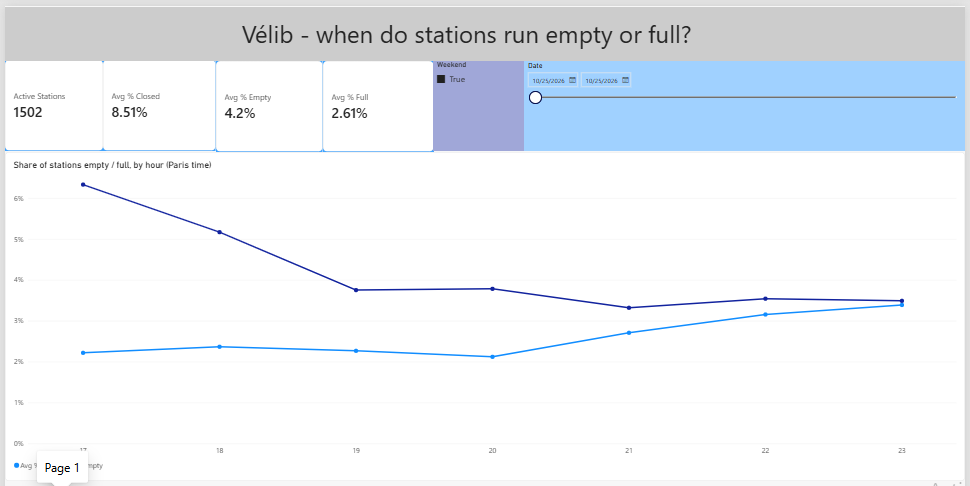
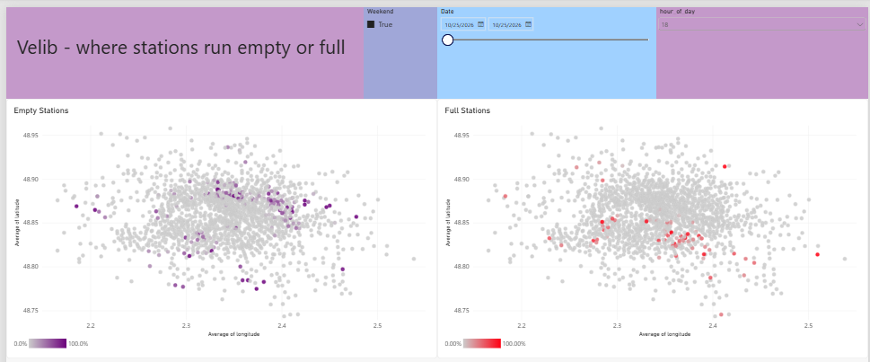

# Vélib' pipeline

I'm building a small data pipeline around Vélib', the bike sharing system in Paris.
Every 5 minutes it saves the state of all ~1,500 stations: how many bikes are there,
how many docks are free, and how many of the bikes are electric.

The goal is to take this raw data all the way to something useful: clean tables,
a dashboard, and in the end a model that guesses how many bikes a station will have
in one hour.

I'm building it step by step, so some parts are not there yet (see the plan at the bottom).

## Why Vélib'

The data is real, public and changes all the time. There's a lot to look at:
morning and evening rush hours, stations that are always empty or always full,
and the weather changing how people ride. It's a good project to practice data
engineering, analysis and a bit of machine learning on the same data.

## What I found so far

**The morning commute moves bikes from homes to offices.** Between 9h and 11h (Paris time),
the share of empty stations almost triples compared to early morning (about 3% to 9%),
and the share of full stations is at its highest too. Bikes leave residential areas and pile
up near offices. In the evening it goes the other way. This is the classic bike sharing
problem called rebalancing: Vélib' has to move bikes around by truck.

| Hour (Paris) | Empty stations | Full stations |
|---|---|---|
| 6h | 2.8% | 2.7% |
| 8h | 4.2% | 1.3% |
| 10h | 8.4% | 4.5% |
| 18h | 6.2% | 1.6% |

**The empty stations are on the hills.** On the map at 9h, most empty stations are around
Montmartre and Belleville / Ménilmontant: areas where people live, and on top of a hill.
People ride down to work in the morning, but very few ride back up. The full stations are
in the center and in the lower, flatter parts of the city.

**I can't say anything about weekends yet.** The pipeline started on a Sunday at 17h,
so the only weekend data I have is one Sunday evening. I need a few full weekends before
comparing them with weekdays.

These numbers are from the first few days only, so they will change as more data comes in.

## The dashboard

Made in Power BI, on top of the dbt tables (file: `dashboard/velib.pbix`).

**Page 1: when do stations run empty or full?**
The share of empty and full stations for each hour of the day, with filters for the date
and weekday / weekend.



**Page 2: where?**
Every station placed by its coordinates and colored by how often it's empty (or full)
at the hour you pick.



A few things I was careful about:

- Percentages are averaged, never added up.
- One scale for both lines, starting at 0, so the chart doesn't make small changes look big.
- Closed stations don't count as empty or full. A closed station with 0 bikes isn't
  "empty", it's just closed.
- The date and weekend filters are shared by both pages.
- The built-in map visual needs a work or school Microsoft account, so I used a scatter
  chart with longitude and latitude instead. No streets in the background, but every
  station is in the right place.

## How it works

```
Vélib' API  -->  fetch_snapshot.py  -->  data/raw/ (compressed files)
                                              |
                                         load_raw.py  -->  PostgreSQL (Docker)
                                                                |
                                                          dbt models
                                                    (staging --> marts)
                                                                |
                                                           Power BI
```

Fetching and loading run every 5 minutes with Windows Task Scheduler.

### 1. Getting the data

`fetch_snapshot.py` calls two feeds:

- `station_information`: the list of stations (name, location, capacity). It almost never changes.
- `station_status`: what's at each station right now (bikes, free docks, electric or mechanical).

Each run saves both answers exactly as they come, compressed, in one folder per day:

```
data/raw/station_status/2026-10-25/T150958Z.json.gz
```

### 2. Loading into PostgreSQL

`load_raw.py` reads the raw files and puts them into 3 tables:

- `stations`: one row per station (name, location, capacity)
- `station_status`: one row per station per snapshot (bikes, docks, e-bikes...)
- `loaded_files`: the list of files already loaded

The loader only loads files that are not in `loaded_files` yet. So I can run it as many
times as I want without getting duplicates. And if the database is down for a while, the raw
files just pile up and the loader catches up the next time it runs.

Each file is loaded in one transaction: either all of it goes in, or nothing does.
That way a crash can't leave a file half loaded.

### 3. Clean tables with dbt

dbt builds clean tables from the raw ones, in a separate `analytics` schema, so the raw
data is never touched.

- **Staging** (views): light cleaning. Clearer column names, Paris time next to UTC,
  a flag for stations that haven't reported in 24 hours, and a flag for closed stations.
- **Marts** (tables), the ones the dashboard and the model use:
  - `dim_stations`: one row per station, with its real capacity and a flag for dead stations
  - `fct_station_hourly`: one row per station per hour: average bikes, % of time empty,
    % of time full, % of time closed, how full the station was

Dead stations are removed in dbt, not in the dashboard, so every report built on these
tables gets the same numbers.

There are 17 dbt tests: no missing ids, no duplicates, every station in the status data
exists in the station list, percentages between 0 and 100, and one row per station per hour.

### 4. Dashboard

Power BI reads the two marts (Import mode) and links them by `station_id`. The dashboard
doesn't refresh by itself yet: I run `dbt build`, then click Refresh in Power BI.

### Some choices I made

- **I keep the raw files as they are.** The API only shows what's happening now.
  If I make a mistake later when cleaning the data, I can redo everything from these files.
- **All times are stored in UTC.** Paris time moves by one hour twice a year
  (it actually happened while I was building this: 2:00 to 3:00 AM happened twice).
  I store UTC and only convert to Paris time for analysis.
- **Files are compressed with gzip.** One run is about 800 KB of JSON. Compressed, it's
  about 95 KB, so around 8 times smaller (the status file even shrinks 16 times).
- **Fetching and loading are two separate steps.** Getting the data only needs the internet,
  loading only needs the database. One failing doesn't stop the other.
- **No foreign key between `station_status` and `stations`.** When Vélib' opens a new station,
  it can show up in the status feed first. I didn't want that to block the whole load,
  so I check it with a test instead. This actually happened: a new station appeared
  and nothing broke.

## Things I found in the data

- The API doesn't use the standard name for its update time. It sends `lastUpdatedOther`
  instead of `last_updated`.
- Some fields are sent twice under two names, like `num_bikes_available` and `numBikesAvailable`.
- The `ttl` field says the data stays fresh for one hour, but stations report every
  minute or two, so I don't rely on it.

## Data quality

**Capacity is not always right.** `capacity` is the number of docks at a station, so
bikes + free docks should never be more than that. But for some stations it is.

- A few stations (like BNF) are over capacity almost all the time, so their capacity in the
  API is probably out of date.
- Others are over only part of the time, probably because extra bikes get parked beyond
  the docks when it's busy.
- And some were over just once or twice, which looks like a glitch.

My first idea was to use the highest value ever seen as the real capacity. But one glitch
was enough to change a station's capacity. So I switched to the 95th percentile: a station
only gets a new capacity if it goes over more than 5% of the time. Right now that's 23
stations.

**Almost half the time, some docks are missing.** In about 45% of the rows, bikes + free
docks are below capacity. That's normal: broken docks and bikes waiting for repair are not
counted.

**Some stations stopped reporting.** About 17 stations hadn't sent any update in more than
24 hours, some not since 2017. They are left out of the hourly table.

**Some stations are closed.** About 2% of the time, a station is closed (not renting or not
taking bikes back). On a normal day that's 4 to 6 stations. But on Sunday 25 October between
17h and 22h, 149 stations were closed at the same time. It happened once, so it looks like
an incident and not a pattern.

## A bug I found in my own pipeline

When I checked how many files I had, I found about 570 snapshots a day instead of 288.
The fetch line was written twice in `run_fetch.bat`, so every run saved two snapshots one
second apart. The data itself was fine (just duplicated), but it took twice the space and
made the "12 snapshots per hour" count wrong. I removed the extra line.

## Project structure

```
velib-pipeline/
├── src/
│   ├── fetch_snapshot.py   # downloads and saves one snapshot
│   ├── load_raw.py         # loads new raw files into PostgreSQL
│   └── check_quality.py    # data quality checks
├── sql/
│   └── 001_create_tables.sql
├── velib_dbt/              # dbt project
│   ├── models/staging/     # light cleaning (views)
│   ├── models/marts/       # final tables
│   └── tests/              # custom tests
├── dashboard/
│   └── velib.pbix          # Power BI dashboard
├── docs/                   # dashboard screenshots
├── docker-compose.yml      # PostgreSQL in Docker
├── .env.example            # database settings to copy into .env
├── run_fetch.bat           # what Task Scheduler runs every 5 minutes
├── requirements.txt
├── data/                   # raw files (not on GitHub)
└── logs/                   # run logs (not on GitHub)
```

## Run it yourself

You need Python 3.10 or newer and Docker. The scheduler part is for Windows.

```
git clone https://github.com/Ahmadramadan123899/velib-pipeline.git
cd velib-pipeline
python -m venv .venv
.venv\Scripts\activate.bat
pip install -r requirements.txt
```

Start the database (set your own password in `.env` first):

```
copy .env.example .env
docker compose up -d
docker exec -i velib-postgres psql -U velib -d velib < sql\001_create_tables.sql
```

Get one snapshot, load it and check it:

```
python src\fetch_snapshot.py
python src\load_raw.py
python src\check_quality.py
```

Build the clean tables (the variables from `.env` need to be set in your terminal):

```
cd velib_dbt
dbt build
```

To run the pipeline every 5 minutes (change the path to where you cloned it):

```
schtasks /create /tn "VelibFetch" /tr "C:\path\to\velib-pipeline\run_fetch.bat" /sc minute /mo 5
```

To see the dashboard, open `dashboard/velib.pbix` in Power BI Desktop. It connects to
`localhost:5433`, database `velib`.

## Plan

- [x] Get the data every 5 minutes and keep the raw files
- [x] Load it into PostgreSQL (running in Docker) and add data quality checks
- [x] Build clean tables with dbt
- [x] Make a dashboard in Power BI: when and where stations run empty or full
- [ ] Predict the number of bikes per station one hour ahead (with the weather)
- [ ] Later: Airflow, tests, CI

## Data source

Vélib' Métropole open data (GBFS feeds).
